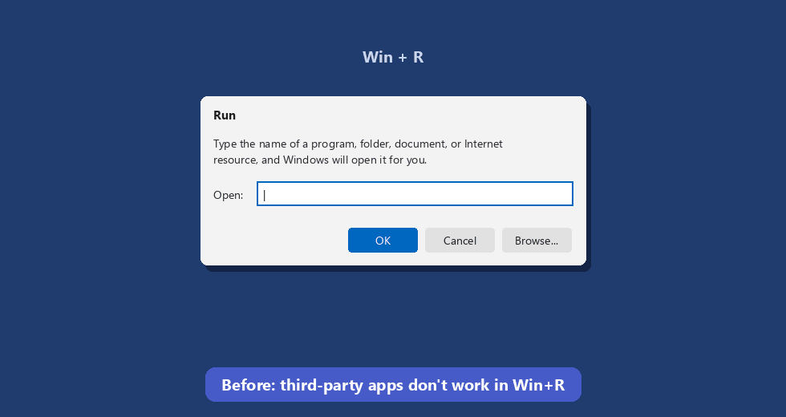

# win-quickrun

[](https://github.com/Unknownuserfrommars/win-quickrun/releases/latest)
[](https://github.com/Unknownuserfrommars/win-quickrun/releases)
[](LICENSE)


[English](README.md)

**为任意 Windows 程序绑定自定义 Win+R 别名。** 命令名为 `quickrun`。



Windows 允许你直接从 Win+R 启动 `notepad` 或 `powershell`，
但第三方应用通常不行。输入 `word` 没有反应，尽管 `winword`
又神奇地可以用。quickrun 修复了这个问题：

```
quickrun -b "C:\...\WINWORD.EXE" -a word
```

然后 **Win+R → `word` → Enter**。就这么简单。

- **无需管理员权限** — 所有内容都写在你的用户注册表配置单元中
- **立即生效** — 无需重启、无需注销，绑定后马上可用
- **持久保存** — 重启后仍然存在，直到你执行 `unbind`
- **安全** — quickrun 会标记自己创建的条目，绝不会删除应用安装程序创建的绑定
- 别名同样可在 **资源管理器地址栏** 中使用

## 安装

### 方式 1：一行命令（推荐）

粘贴到任意 PowerShell 窗口：

```powershell
irm https://raw.githubusercontent.com/Unknownuserfrommars/win-quickrun/main/install.ps1 | iex
```

这会将最新发布版 exe 下载到
`%LocalAppData%\Programs\quickrun`，并将其加入 PATH。无需管理员提示，
以后也可以通过 `quickrun update` 就地更新。

想要安装到 `C:\Program Files`，让整台机器可用？请在仓库克隆目录中用
提升权限的 shell 运行：

```powershell
.\install.ps1 -SystemWide
```

这不是默认方式，因为 Program Files 会让每次后续自更新都需要管理员权限。
你也可以直接从 [Releases](../../releases) 获取 `quickrun.exe` 并自行管理，
类似 yt-dlp 的使用方式。

### 方式 2：pip

```
pip install -e .
```

这会通过 Python 的 Scripts 目录提供 `quickrun` 命令。

### 方式 3：不安装

```
python quickrun.py <command> ...
```

## 用法

```
quickrun bind <path\to\app.exe> <alias>     # 绑定一个别名
quickrun -b <path\to\app.exe> -a <alias>    # 同样操作，参数风格
quickrun alias <old_cmd> <new_alias>        # 为已有命令创建新别名
quickrun alias --cmd <old_cmd> <new_alias>  # 改为创建终端（PowerShell）别名
quickrun list                               # 显示你的绑定
quickrun unbind <alias>                     # 移除一个绑定
quickrun unbind all                         # 移除所有 quickrun 管理的绑定
quickrun del_alias <alias>                  # 移除一个 quickrun 别名
quickrun find <name>                        # 在电脑上搜索 exe 并询问是否绑定
quickrun quickstart                         # 自动检测已安装应用
quickrun quickstart --ui                    # 交互式选择应用分类
quickrun update                             # 从 GitHub 自更新（也可用：-U）
quickrun --version                          # 打印版本号
```

### 示例

```
quickrun bind "C:\Program Files (x86)\Microsoft Office\Root\Office16\WINWORD.EXE" word
quickrun -b "D:\Tools\Everything\Everything.exe" -a ev
quickrun alias powershell ps
quickrun bind "%LocalAppData%\Programs\obsidian\Obsidian.exe" notes
```

### Alias：给 Windows 已经认识的命令换个短名

```
quickrun alias winword word
quickrun alias powershell ps
quickrun del_alias ps
```

`alias` 会通过 App Paths 或 PATH 解析旧命令，然后写入一个新的永久用户级
App Paths 条目。除非传入 `--force`，否则它不会覆盖已有名称。

### 终端别名：`alias --cmd`

Win+R 别名在终端中不起作用（shell 不读取 App Paths）。为此提供了 `--cmd`：

```
quickrun alias --cmd quickrun qr     # 现在 "qr" 可以在 PowerShell 中使用
```

单独的 `Set-Alias` 只在当前会话有效，所以 quickrun 会把带标记的
`Set-Alias` 行写入你的 PowerShell 配置文件，它们在每次启动 shell 时
运行。PowerShell 7 和 Windows PowerShell 5.1 都装了就都会写入，
并且只会为你确实安装了的 shell 创建配置文件。
在**新**终端窗口中生效。`quickrun del_alias qr` 可以再次移除它；
`quickrun list` 会在单独的区块中显示终端别名。（不覆盖 cmd.exe——
这是 PowerShell 功能。）

### Find：定位你不知道路径的 exe

```
> quickrun find obsidian
Searching for "obsidian" ...
1 result(s) in 1.2s

  Found: C:\Users\you\AppData\Local\Programs\obsidian\Obsidian.exe
Alias to bind it to (press Enter to skip): notes
[OK] Win+R -> "notes" now opens C:\Users\you\...\Obsidian.exe
```

`find` 会先查询注册表（App Paths + 安装程序记录），再对常见安装目录
做限制深度、约 10 秒硬性时间预算的扫描——通常 1-3 秒内出结果。
有多个匹配时会显示编号列表供选择；在任意提示处直接按 Enter 即跳过，
不会绑定任何内容。

### Quickstart：自动检测已安装应用

```
quickrun quickstart            # 打开交互式选择器（在控制台中）
quickrun quickstart --no-ui    # 跳过选择器，扫描所有分类
quickrun quickstart --area coding --area work      # 脚本化指定分类
quickrun quickstart --apps "telegram, obsidian"    # 查找你自己指定的应用
quickrun quickstart --dry-run  # 只显示将要绑定的内容
quickrun quickstart --yes      # 不询问，直接绑定
```

Quickstart 会检测常见应用，并建议友好的别名：

| 分类 | 应用 | 别名 |
|---|---|---|
| Working | Word / Excel / PowerPoint / Outlook / OneNote / Access | `word` `msword` / `excel` / `powerpoint` `ppt` / `outlook` / `onenote` / `access` |
| Browsers | Chrome / Firefox | `chrome` / `firefox` |
| Coding & AI | VS Code / Notepad++ / Claude / Codex / Cursor | `vscode` / `npp` / `claude` / `codex` / `cursor` |
| Utilities | 7-Zip | `7z` |
| Media & Games | VLC / Steam / Spotify | `vlc` / `steam` / `spotify` |
| Chat | Telegram / WeChat / QQ | `telegram` `tg` / `wechat` `wx` / `qq` |

如果某个名称在你的系统中已经有含义（例如 Office 已经在机器范围内注册了
`excel`），quickrun 会跳过它，绝不会覆盖，除非你传入 `--force`。

在控制台中，`quickstart` 默认打开一个小型键盘选择器：Up/Down 移动，
Space 切换，Enter 继续，`A` 切换全部分类，`Q` 取消。默认不预选任何
分类——自己挑选想要的。最后一行 **Custom apps** 允许你输入逗号分隔的
应用名（例如 `telegram, obsidian, notion`）；每个都会做一次快速
`find` 搜索，找到/未找到的结果会汇总后只需确认一次。

`--no-ui` 跳过选择器并扫描所有分类（输出被管道或脚本调用时也会
自动采用此行为）。`--area` 和 `--apps` 同样会跳过选择器。

## 命令参考

| 命令 | 别名 | 选项 |
|---|---|---|
| `bind <exe> <alias>` | `b`, `-b`, `-bind` | `-a/--alias`（参数风格别名），`-f/--force` 覆盖已有项 |
| `alias <old_cmd> <new_alias>` | `a`, `-alias`, `--alias` | `--cmd` 通过 PowerShell 配置文件创建终端别名，`-f/--force` 覆盖已有项 |
| `del_alias <alias>` | `da`, `-del_alias`, `--del_alias` | 同时移除 Win+R 和/或终端别名；`-n/--dry-run`, `-f/--force` |
| `unbind <alias>` / `unbind all` | `u`, `-u`, `-unbind` | `-n/--dry-run`, `-y/--yes`, `-f/--force` 同时移除非 quickrun 创建的条目 |
| `list` | `l`, `ls`, `-l`, `-list` | `--all` 包含安装程序创建的用户条目 |
| `quickstart` | `qs`, `-q`, `-quickstart` | 默认打开选择器；`--no-ui`, `--area <area>`, `--apps "a, b"`, `-y/--yes`, `-n/--dry-run`, `-f/--force` |
| `find <name>` | `f`, `-find`, `--find` | 交互式；按 Enter 跳过 |
| `update` | `up`, `-U`, `--update` | （仅独立 exe 可用） |
| `--version` | `-V` | |

别名规则：不区分大小写，不能包含空格，也不能包含 `\ / : * ? " < > |`。
末尾的 `.exe` 会被自动去掉。

## 工作原理

当你在 Win+R 中输入一个名称时，Windows 会在检查 PATH 之前（并且也会额外）
检查 **App Paths** 注册表项：

```
HKCU\Software\Microsoft\Windows\CurrentVersion\App Paths\<alias>.exe
```

`winword` 正是这样工作的：Office 安装时会在 HKLM 下注册 `winword.exe`。
quickrun 会在 **HKCU**（你的用户配置单元）下写入同类条目，因此无需管理员权限，
并且会立即生效。quickrun 创建的每个条目都会带有 `QuickRunManaged` 标记值，
这样 `unbind` 和 `list` 就能区分 quickrun 自己的绑定和安装程序创建的绑定。

## FAQ

**绑定是永久的吗？**
是的。它们是注册表值，会在重启后保留，并一直存在，直到你执行 `unbind`。
唯一可能让别名失效的情况是目标应用被移动或卸载；发生这种情况时重新绑定即可。

**需要管理员权限吗？** 不需要。所有内容都是按用户保存的（HKCU）。

**启动会经过 cmd.exe 吗？我看到有窗口一闪而过。**
不会。Win+R 解析别名后直接启动目标 exe，中间没有任何 shell 参与。
GUI 应用打开时完全不会出现控制台。只有两种情况会出现短暂的控制台窗口：
别名指向的是一个*控制台*程序（那个窗口本身就是该程序），或者你在
Win+R 中启动了 `quickrun` 本身（它是命令行工具；现在它会保持窗口
打开，方便阅读帮助信息）。

**别名可以覆盖内置名称吗？**
可以。HKCU 优先于 HKLM，所以你确实可以让 `notepad` 在自己的账户下打开别的东西。
因此，覆盖已有名称时必须使用 `--force`。

**如何更新？**
`quickrun update`（或 `quickrun -U`）会检查最新的 GitHub release，
并就地替换 exe。如果你通过 pip 安装，请改用 `git pull` + `pip install -e .`。

**如何移除所有内容？**
`quickrun unbind all` 会在确认后移除所有 quickrun 管理的绑定。
quickrun 不会在其他地方存储任何内容。

## 构建 exe

```powershell
pip install pyinstaller
pyinstaller --onefile --name quickrun --console quickrun.py
```

结果是 `dist\quickrun.exe`，一个独立的单文件程序，类似 yt-dlp。
`install.ps1` 会执行构建（如果需要），将 exe 复制到
`%LocalAppData%\Programs\quickrun`，并把它加入 PATH。

## 许可证

MIT
